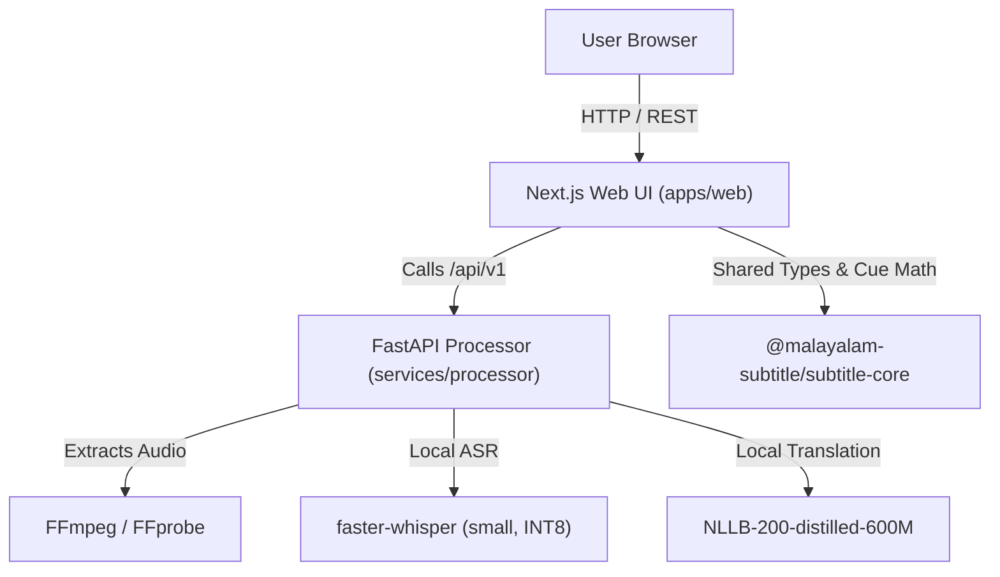

# FrameFlow AI / Malayalam Subtitle AI Architecture

## 1. System Overview

Malayalam Subtitle AI is structured as a pnpm monorepo containing:
1. **`apps/web`**: Web application built with Next.js (App Router), React, TypeScript, and Tailwind CSS.
2. **`packages/subtitle-core`**: Framework-independent TypeScript library managing subtitle data structures, millisecond-based cue math, timing validation, SRT/VTT parsing and serialization.
3. **`services/processor`**: Python FastAPI microservice providing FFmpeg media extraction, Whisper-based speech recognition, and NLLB-based translation.



---

## 2. Monorepo Structure

```text
d:/Projects/FrameFlow_AI/
├── apps/
│   └── web/                        # Next.js App Router frontend
│       ├── public/
│       ├── src/
│       │   ├── app/                # Pages and layouts
│       │   ├── components/         # Accessible UI primitives & layout
│       │   ├── features/           # Upload, player, editor, timeline, export
│       │   ├── hooks/              # Player sync & keyboard shortcuts
│       │   ├── lib/                # API client, config, time formatting
│       │   └── styles/             # Global CSS and design tokens
│       ├── package.json
│       └── tsconfig.json
├── services/
│   └── processor/                  # FastAPI Python backend
│       ├── app/
│       │   ├── main.py
│       │   ├── api/                # Endpoints (health, projects, jobs, export)
│       │   ├── core/               # Settings, errors, security
│       │   ├── schemas/            # Pydantic v2 data models
│       │   ├── services/           # Media, jobs, transcription, translation
│       │   └── providers/          # ASR & Translation interface implementations
│       ├── tests/
│       └── requirements.txt
├── packages/
│   └── subtitle-core/              # Framework-independent subtitle logic
│       ├── src/
│       │   ├── types.ts
│       │   ├── validate-cues.ts
│       │   ├── build-cues.ts
│       │   ├── srt/
│       │   ├── vtt/
│       │   └── index.ts
│       ├── tests/
│       └── package.json
├── docs/                           # Documentation
├── .env.example
├── package.json                    # Workspace root
└── pnpm-workspace.yaml
```

---

## 3. Data Flow & Millisecond Invariant

- **Integer Milliseconds:** All internal representations of time (`startMs`, `endMs`, `durationMs`) are strictly non-negative integers.
- **Conversion on Boundary:** Timestamps in format `HH:MM:SS,mmm` (SRT) or `HH:MM:SS.mmm` (VTT) are created and parsed solely at import/export boundaries in `packages/subtitle-core`.
- **Decoupled Processing:** Long-running ASR and translation tasks run as background jobs with polling status checks, leaving the client video playback and editor fully responsive.
